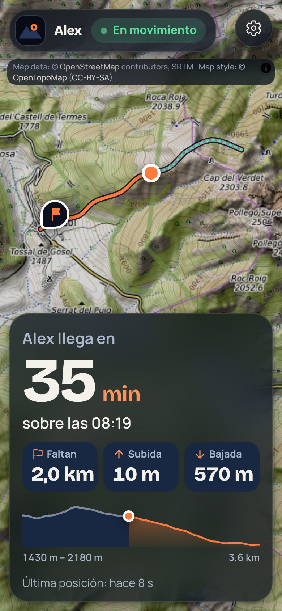
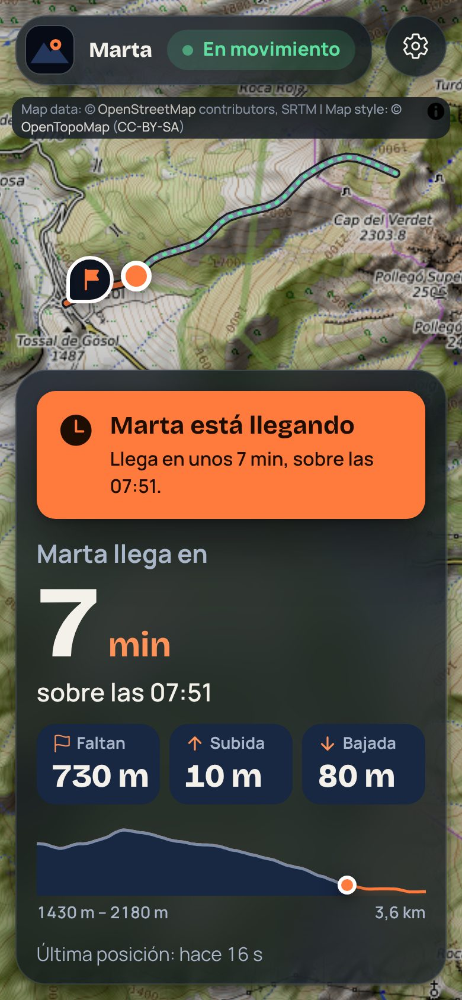
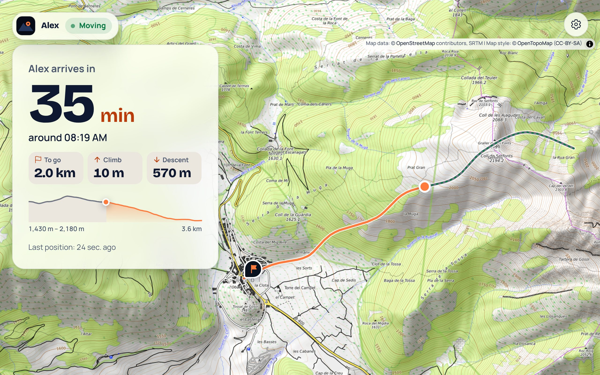

# ¿Dónde estoy?

**Live location sharing with an arrival time you can trust in the mountains.**

When you go trail running or hiking, the person waiting for you has no idea
when you will arrive. Live-tracking apps show *where* you are; map apps
estimate arrival as if the ground were flat. *¿Dónde estoy?* ("Where am I?")
shares your position through a link and answers the question that matters:

> **Alex arrives in ~22 min (around 10:45)**

The estimate comes from your real pace on this outing, adjusted for the climb
and descent still ahead of you.

[](https://github.com/alexm3133/donde-estoy/actions/workflows/ci.yml)
[](LICENSE)

| Viewer (phone) | Arriving-soon alert | Runner set-up |
| --- | --- | --- |
|  |  |  |



<!-- TODO: add a short GIF of a live session here (docs/screenshots/demo.gif). -->

## What it does

- **Runner**: start a session, choose a destination (upload a GPX route or tap
  a point on the map), share the link — WhatsApp, the system share sheet or
  copy/paste.
- **Viewer**: no account, no app. Open the link and see a live topographic
  map, a big ETA, distance / climb / descent left, an elevation profile and
  whether the runner is moving, stopped or out of coverage. Updates in real time.
- **Smart ETA**: Tobler's hiking function for the terrain, multiplied by a pace
  factor learned live for uphill, flat and downhill separately.
  See [How the ETA works](#how-the-eta-works).
- **Alerts** for the viewer: "arriving in 15 min", "has arrived", and a safety
  alert when the runner has not moved for X minutes (the runner chooses X).
- **Privacy**: unguessable link tokens (stored only as hashes), sessions expire
  by themselves, "stop sharing" erases all location data immediately, nothing
  is kept after expiry. No accounts, no analytics.
- **Languages**: Spanish, Catalan, English.
- **Themes**: dark by default, light available; WCAG AA contrast, large type.

## Try it in two minutes

You need Docker.

```bash
cp .env.example .env
```

```bash
docker compose up --build
```

Open <http://localhost:8080> and press **"Ver una demo" / "See a demo"**: a
simulated runner descends from Pedraforca to Gósol. Copy the share link and
open it in another window to see the viewer side.

> Browsers only give GPS access to secure origins. `localhost` counts as
> secure; to test from a real phone, put the app behind HTTPS (any reverse
> proxy or tunnel) and set `DE_PUBLIC_URL` / `DE_CORS_ORIGINS` accordingly.

## Local development

Two terminals. SQLite is used by default, so no database to install.

**Backend** (Python 3.12+):

```bash
cd backend
python -m venv .venv && source .venv/bin/activate
pip install -e ".[dev]"
alembic upgrade head
uvicorn app.main:app --reload
```

The API is at <http://localhost:8000> (interactive docs at `/docs`).

**Frontend** (Node 22+):

```bash
cd frontend
npm install
npm run dev
```

The app is at <http://localhost:5173>; `/api` is proxied to the backend.

**Simulate a runner** while working on the viewer UI:

```bash
cd backend
python scripts/simulate_runner.py --progress 0.4 --speed 4
```

It prints a viewer link and keeps the fake runner moving.

### Checks

```bash
cd backend && ruff check . && ruff format --check . && pytest
```

```bash
cd frontend && npm run lint && npm test && npm run build
```

CI runs exactly these on every push and pull request.

## How the ETA works

The engine lives in [`backend/app/eta`](backend/app/eta) and is pure Python
with no I/O, so it is easy to read and test.

1. **Terrain model.** [Tobler's hiking function](https://en.wikipedia.org/wiki/Tobler%27s_hiking_function)
   gives the speed of a reference walker for any slope
   (`6·exp(−3.5·|slope + 0.05|)` km/h): fastest on a gentle descent, slower on
   steep ground both up *and* down. Unlike Naismith's rule it is continuous and
   penalises steep descents, which matters on technical trails.
2. **Your pace.** You are modelled as that walker times a *pace factor*. We keep
   one factor per terrain class — uphill, flat, downhill — because a strong
   climber can be a cautious descender.
3. **Live calibration.** Every time you cover ~30 m we compare how long it took
   with what the reference walker would need, and update the factor for that
   terrain. Little data is blended with a prior (your overall pace, and before
   that a default per activity), and old data fades, so the estimate follows
   fatigue. Breaks are detected and do not count as slow pace.
4. **Estimate.** The remaining route is cut into ~25 m legs; each leg costs
   `reference time / your factor for its terrain`. The sum is the moving time
   left.

With a GPX route the remaining climb is known exactly. With a tap-on-map
destination only the straight line is known, so the ETA is rougher (distance
× 1.3 at your average pace) — a routed version is on the roadmap.

## The browser GPS limitation (important)

Browsers stop delivering GPS fixes when the screen turns off or the page goes
to the background, especially on iOS. The web version therefore:

- holds a **Screen Wake Lock** so the display stays on while sharing,
- tells the runner clearly to keep the page open and visible,
- **buffers positions** on the phone when there is no coverage and sends them
  in order when signal returns,
- shows viewers "no signal" (with the last known position) instead of
  pretending the runner stopped.

The real fix is native background location. The location layer is already
behind an interface ([`frontend/src/location`](frontend/src/location)) and the
project is Capacitor-ready, so a background-geolocation plugin can replace the
browser provider without touching the rest of the app.

## Map tiles

The default map is [OpenTopoMap](https://opentopomap.org) (map data ©
OpenStreetMap contributors, SRTM; map style © OpenTopoMap, CC-BY-SA), shown
with its attribution as required. Their servers are a community service meant
for moderate use: if you deploy this for more than friends and family, set
`VITE_TILE_URL`, `VITE_TILE_MAX_ZOOM` and `VITE_TILE_ATTRIBUTION` to a tile
provider you have an agreement with (or your own tile server).

## Configuration

All settings are environment variables; see [`.env.example`](.env.example).

| Variable | Default | Meaning |
| --- | --- | --- |
| `DE_DATABASE_URL` | SQLite file | SQLAlchemy async URL (`postgresql+asyncpg://…` in production) |
| `DE_PUBLIC_URL` | `http://localhost:5173` | Public URL of the web app |
| `DE_CORS_ORIGINS` | `http://localhost:5173` | Origins allowed to call the API |
| `DE_DEFAULT_SESSION_HOURS` / `DE_MAX_SESSION_HOURS` | `8` / `24` | Session lifetime |
| `DE_FINISHED_GRACE_MINUTES` | `60` | How long a link survives after arrival |
| `DE_CREATE_RATE_LIMIT_PER_HOUR` | `30` | Sessions per IP per hour (`0` = off) |
| `VITE_TILE_URL` (build time) | OpenTopoMap | Raster tile template |
| `VITE_API_BASE` (build time) | same origin | API base URL, for native builds |

## Project layout

```
backend/    FastAPI app, ETA engine, tests, Alembic migrations
frontend/   Ionic + React + TypeScript app (Vite), Capacitor config
docs/       Architecture notes and screenshots
```

[`docs/ARCHITECTURE.md`](docs/ARCHITECTURE.md) explains the data model, the
API and how the pieces fit together.

## Roadmap

- [ ] Native Android / iOS builds with background geolocation (Capacitor)
- [ ] Web Push, so viewers get alerts with the page closed
- [ ] Trail routing for tap-on-map destinations (real path + elevation instead
      of a straight line)
- [ ] Multi-process live updates (Redis or PostgreSQL LISTEN/NOTIFY behind the
      existing hub interface)
- [ ] Pace memory across outings (opt-in), to start calibrated
- [ ] ETA range display and accuracy tracking on real outings
- [ ] Offline map tiles for the runner; code-split the map to shrink the bundle
- [ ] More languages (Basque, Galician, French…)

## Contributing

Contributions are very welcome — see [CONTRIBUTING.md](CONTRIBUTING.md).
Good first issues: translations, ETA test cases from your own GPX tracks,
accessibility reviews.

## License

[MIT](LICENSE)
